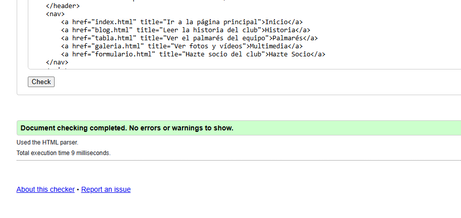
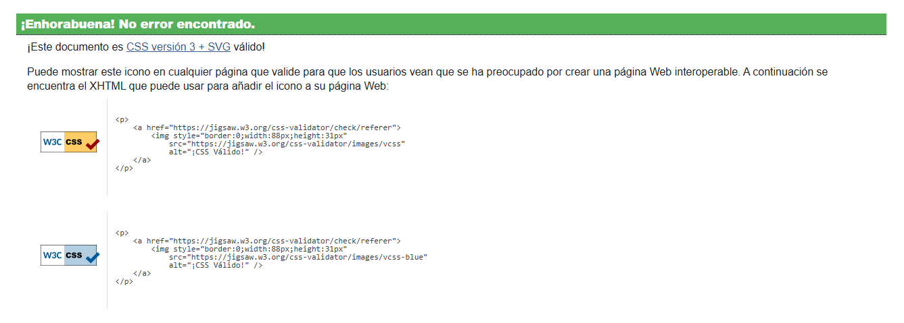

# Fan Web FC Barcelona

Sitio web educativo sobre el Fútbol Club Barcelona creado como práctica de HTML5.

## Autoría
- Nombre y apellidos: Cairo José Carvajal Pérez
- Curso: 1º DAM 
- Módulo: Lenguaje de marcas 
- Fecha: 12/11/2026

## Sitio publicado
- Web en GitHub Pages: [Abrir sitio](https://princecairo7.github.io/fc-barcelona-web/)
- Repositorio: [Abrir repositorio](https://github.com/princecairo7/fc-barcelona-web)

## Estructura del proyecto
- `index.html`: Portada con resúmenes.
- `blog.html`: Historia del club.
- `tabla.html`: Títulos ganados.
- `galeria.html`: Imágenes y recursos audiovisuales.
- `formulario.html`: Solicitud para hacerse socio.
- `rss.xml`: Canal de sindicación.
- `css/estilos.css`: Hoja de estilos común.

## Tecnologías utilizadas
- HTML5
- CSS
- XML y RSS
- Git, GitHub y GitHub Pages

## Validación
### HTML

### CSS

### RSS

## Dificultades encontradas
2. Validar correctamente las listas anidadas: Ajusté la etiqueta ul para que estuviera dentro del li correcto.
3. Rutas relativas multimedia: Corregí el nombre de la carpeta de vídeo para que coincidiera exactamente en minúsculas.

## Decisiones técnicas
- Formatos de imagen: Usé JPG para fotos, PNG para logos transparentes, y GIF para animaciones simples.
- CSS: Se aplica una hoja externa para todas las páginas logrando separación entre estructura y estilo.